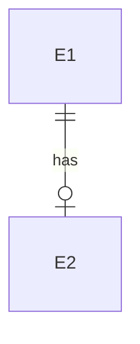

# Logical data model format

Format used by zkit 0.3.0. A project's `data.md` describes the facts its design must remember, including transient state. An entity ID connects three views of the same fact: its catalog entry, its relationships, and its lifecycle. The [data template](../../skills/data/references/data-template.md) defines the full document layout.

## Entity catalog

Use one row per logical entity. Keep its `E-n` identifier stable across edits. Give its name and meaning, the actors that write it, expected volume and growth with units or resource-math assumptions, retention, storage class, sensitivity, access and consistency needs, and the requirements served. Describe individual fields when they carry an invariant, drive size, or affect sensitivity. Record the owning part in the architecture parts table once the parts are known.

## Worked example

An instrument tracks its active sensors and keeps one current reading per sensor. Assume FR-1 requires displaying the latest accepted temperature for each active registration and the design supports 16 active sensors. Sizes below are illustrative logical size estimates.

### Entity catalog

| ID | Entity | Meaning | Writers (actors) | Volume | Growth | Retention | Storage class | Sensitivity | Needs | Serves |
|---|---|---|---|---|---|---|---|---|---|---|
| E-1 | Sensor registration | One activation of a physical sensor | Operator | 16 sensors × 16 B | 16 B per registration up to the limit | Until removal or shutdown | memory | internal | One active registration per physical sensor | FR-1 |
| E-2 | Current reading | Most recent accepted temperature for one active sensor | Controller on receipt of a sensor sample | Up to 16 readings × 24 B | 24 B on first reading, then zero net growth per update | Until registration removal or shutdown | memory | internal | Accept only a newer sequence number for the same registration | FR-1 |

### Logical fields

Include fields where identity, units, constraints, or interpretation affect a requirement. For this example, the sampler learns its registration ID during registration.

| Entity | Field | Meaning and constraint |
|---|---|---|
| E-1 | sensor ID | Identifies the physical sensor across registrations. |
| E-1 | registration ID | Fresh for each registration, including after restart. A retired ID cannot be reused while its frames could still arrive. |
| E-2 | registration ID | Identifies the reading and its owning registration. At most one current reading exists per registration. |
| E-2 | sequence | Nonnegative sample number, strictly increasing at the sampler within a registration. Reset or rollover requires a fresh registration. Gaps are allowed. |
| E-2 | temperature | Measured temperature in degrees Celsius. The frame contract defines its encoding. |

### Relations

Each reading belongs to exactly one active sensor. A newly registered sensor can have zero readings. After its first accepted sample it has one. The sequence number determines which update wins, a rule the cardinality alone cannot express.

### Lifecycle and copies

| ID | Created by | Changed by | Deleted by / when | Copies | Copy lifetime |
|---|---|---|---|---|---|
| E-1 | Operator registers a sensor | Identity fixed for the registration | Operator removes sensor or instrument shuts down | Registration ID held by sampler and carried in sample frames | Sampler retains the ID until deregistration or shutdown. In-flight frames can outlive registration. |
| E-2 | Controller accepts first sample | Controller accepts a newer sample | Controller deletes the reading on registration removal or shutdown | Display buffer | Cleared on refresh within 1 s, or at shutdown |

The tables and diagram illustrate the entity format. For a complete instrument design, the memory strategy also describes the allocation, size, lifetime, and exhaustion behavior of each relevant region (`M-n`).

## Entity states

When a requirement depends on an entity's state, describe the state vocabulary in `data.md`. Identify the entity, the aspect of its state being described, each allowed value, and the condition that makes that value true. State whether the value is recorded explicitly or derived from other facts. This section is optional.

**Entity:** E-1 · **Aspect:** reading availability · **Representation:** derived from the E-2 relation

| Value | Condition |
|---|---|
| awaiting_sample | The active registration has zero current readings. |
| has_reading | The active registration has one current reading. |

### MC-1 Sample acceptance

This is a worked excerpt of the existing `mechanics.md` [state-machine format](../../skills/mechanics/references/mechanics-template.md). In a project, mechanics owns this table. Its subject is **E-1 / reading availability**, its owner is **B-2**, and its input is [I-1](internal-interface-format.md#example). Evaluate the guard and apply its effect as one operation relative to other samples and registration removal. Discard frames for inactive registration IDs before looking up a reading. Removing a registration ends this machine instance and deletes its E-2. A new instance starts in `awaiting_sample`.

| State | Event | Guard | Next state | Effects |
|---|---|---|---|---|
| awaiting_sample (initial) | sample for this registration | First accepted sample | has_reading | Create E-2 with the incoming sequence and temperature. |
| has_reading | sample for this registration | Incoming sequence exceeds stored sequence | has_reading | Update sequence and temperature together on the existing E-2. |
| has_reading | sample for this registration | Incoming sequence equals or falls below stored sequence | has_reading | Discard frame. Preserve E-2. |

### Trace through the three artifacts

Sensor S has deregistered from R7 and registered again as R8. R7's reading has been deleted. These frames arrive in order on I-1 at B-2.

| Frame | Registration | Sequence | Temperature (°C) | Decision under MC-1 | E-2 for R8 after receipt | E-1 reading availability for R8 |
|---|---|---|---|---|---|---|
| First | R8 | 1 | 20 | Create | 1, 20 °C | has_reading |
| Newer | R8 | 3 | 21 | Update | 3, 21 °C | has_reading |
| Delayed from previous registration | R7 | 99 | 30 | Discard | 3, 21 °C | has_reading |
| Delayed within current registration | R8 | 2 | 19 | Discard | 3, 21 °C | has_reading |
| Duplicate | R8 | 3 | 21 | Discard | 3, 21 °C | has_reading |

The third frame illustrates why sequence comparison is scoped to a registration. A receiver that compared 99 with 3 before checking the registration could overwrite the current temperature with a retired sensor reading.

## References and validation

- Use `E-1` in tables and `E1` for the corresponding Mermaid node. Use relationship ends for cardinality and accompanying text for invariants that need explanation.
- The [data checker](../../skills/data/scripts/check_data.py) checks duplicate catalog IDs, core fields, requirement references against available requirements, lifecycle coverage, and agreement between entity IDs in the catalog and ER diagram. It does not interpret cardinalities, prove uniqueness, compare sequence numbers, or verify the stated deletion times. Those rules need semantic review.
- Each catalog entity should have exactly one lifecycle row. The 0.3.0 data checker reports duplicate lifecycle rows as errors. The [mechanics checker](../../skills/mechanics/scripts/check_mechanics.py) validates transition targets and reachability within a machine. Matching the vocabulary to its entity and aspect currently requires review.
- The [architecture checker](../../skills/architecture/scripts/check_architecture.py) checks that each entity has one owning part. Several actors may write the same entity.
- An interface refers to the entity when the connection is relevant. The interface contract specifies the exchanged representation. For example, a sample carries the sensor identity, sequence number, and temperature. The catalog defines which sample qualifies as the current reading after receipt.
