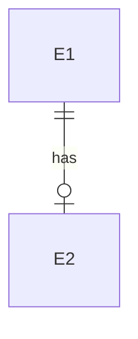

# Data template

Aim for roughly 1,500-3,000 words. Tables over prose. Sections in this order; drop one only if irrelevant and say so in one line. No tables/indexes/DDL, no owning parts (B-n), products only where a requirement fixes them.

````markdown
# <Name> — Data

> **Links:** [concept](concept.md) · [requirements](requirements.md) · [resource-math](resource-math.md) · [contracts](contracts.md) · [decisions](decisions.md)
> **Status:** draft / agreed (agreed only when the clarity gate passes, SKILL.md step 5) · **Date:** <date> · **Based on:** requirements.md (<date>), resource-math.md (<date>), contracts.md (<date>)
> **Counts:** <n> E · <n> M   (the checker compares these with the tables)

## 1. Summary
The data in ≤5 sentences: how many entities, which storage classes, the biggest volume driver, the longest copy chain, the main finding.

## 2. Entity catalog
| ID | Entity | Meaning | Writers (actors) | Volume | Growth | Retention | Storage class | Sensitivity | Needs | Serves |
|---|---|---|---|---|---|---|---|---|---|---|
| E-1 | Sensor registration | One activation of a sensor | Operator | Up to 16 × 16 B | 16 B per active registration | Until removal or shutdown | memory | internal | One active registration per sensor | FR-1 |
| E-2 | Current reading | Latest accepted temperature for a registration | Controller on sample receipt | Up to 16 × 24 B | 24 B on first sample, then zero net growth per update | Until registration removal or shutdown | memory | internal | Accept a newer sequence for the same registration | FR-1 |

`Volume`/`Growth`: a figure with its unit or the resource-math assumption `A-n` it comes from. `Storage class`: relational / document / file-blob / log / queue / cache / memory / flash / register. `Sensitivity`: public / internal / personal / secret. `Needs`: transaction with E-m, read-mostly, append-only, latency budget L-n, ...

## Logical fields
Optional. Describe fields that affect identity, units, invariants, size or sensitivity. The catalog owns the entity ID.

| Entity | Field | Meaning and constraint |
|---|---|---|
| E-1 | registration ID | Fresh on registration, including after restart. Reuse is safe only after all frames carrying the old ID have expired. |
| E-2 | registration ID | Identifies the owning registration. At most one current reading exists per registration. |
| E-2 | sequence | Increases within one registration. A reset or rollover requires a new registration. Gaps are allowed. |
| E-2 | temperature | Accepted sample in degrees Celsius. The interface contract defines its encoding. |

## Entity states
Optional. Give each requirement-bearing aspect its own vocabulary and stable anchor. Combine the entity ID with a short permanent aspect key. Keep that key when renaming its display label. Describe once per aspect where its value is recorded or from which facts it is derived.

<a id="E-1-reading-availability"></a>

**Entity:** E-1 · **Aspect:** reading availability · **Representation:** derived from the presence of a related E-2

| Value | Condition |
|---|---|
| awaiting_sample | The active registration has no current reading. |
| has_reading | The active registration has one current reading. |

Once mechanics defines the governing rule, add its link here, for example [MC-1 sample acceptance](mechanics.md#MC-1).

## 3. Relations

Nodes are the catalog ids written `E1`, `E2`. One line per relation below the diagram only where the meaning is not obvious (cardinality, invariants such as "action key unique per task").

## 4. Lifecycle and copies
| ID | Created by | Changed by | Deleted by / when | Copies (backups, caches, replicas, derived data, logs, provider side) | Copy lifetime |
|---|---|---|---|---|---|
| E-1 | Operator registers sensor | Identity fixed | Operator removes sensor or instrument shuts down | Registration ID on sampler and in frames | Sampler retains it until removal or shutdown. In-flight frames can outlive registration. |
| E-2 | Controller accepts first sample | Controller accepts a newer sample | Registration removal or shutdown | Display buffer | Cleared on refresh within 1 s or at shutdown |

The longest chain of copies, computed against the deletion and retention requirements (e.g. 14 + 7 = 21 ≤ 30).

## 5. Memory strategy
For in-process and embedded systems (otherwise write "not applicable: <reason>"):
| ID | Region | Contents | Lifetime | Size | Allocation | On exhaustion | Serves / limit |
|---|---|---|---|---|---|---|---|
| M-1 | Registration slots | Active E-1 and optional E-2 | Instrument runtime | 16 × (16 B + 24 B) = 640 B | static | Refuse a new registration when all slots are occupied | FR-1, L-2 |

The region record is the destination for references such as [M-1](#M-1). Cite its entities and applicable resource limits here. During architecture, identify the owning part and known readers and writers of the region alongside the parts and interfaces. Once defined, link the governing allocation or access rule in mechanics.

## 6. Storage classes and totals
Per class: the entities in it, why this class (access pattern, consistency, cost), the total volume and growth against the resource-math limits.

## 7. Findings and consequences
Number the items plainly (`1.`, `2.`); id-like labels (`F-1`, `G-1`) belong to the id registry (`flow/scripts/ids.py`) and fail its check.
Requirement issues found (history vs deletion, speed vs consistency, retention vs cost) with the decision taken or pending. Constraints for the architecture, tagged `→ architecture: …`, `→ mechanics: …`, `→ resilience: …`.

## 8. Risks, assumptions and open questions
Ranked; every assumed volume or retention has the cheapest way to validate.

## 9. Consistency check
Date; `check_data.py` result (errors / warnings left and why); verdict of the independent reviewer; what was fixed; what stays open.

## Sources
Numbered URLs; delegated findings link to `[R-n]` reports with their confidence.
````
