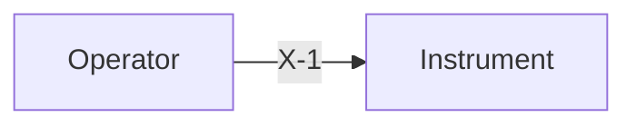
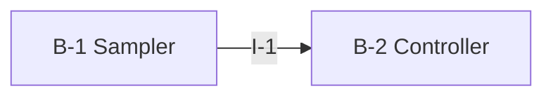

# Temperature instrument

> **Counts:** 2 B · 1 I · 3 S
> **Based on:** requirements.md (2026-11-20), data.md (2026-11-20), contracts.md (2026-11-20), resource-math.md (2026-11-20).

## Parts

| ID | Part | Responsibility | Owns (E-n, in-process state) | Faces (X-n) | Limits (L-n) | Serves |
|---|---|---|---|---|---|---|
| B-1 | Sampler | Tag outgoing readings with their registration. | — | — | — | FR-1 |
| B-2 | Controller | Accept samples and display the latest reading. | E-1, E-2, M-1 | X-1 | L-1 | FR-1 |

## Design constraints

| ID | Parameter or rule | Allowed value | Scope | Basis | Applies to | Verification |
|---|---|---|---|---|---|---|
| DC-1 | Active sensor registrations | ≤ 16 registrations | Per controller, summed across its ports | D-1 | B-2, E-1, X-1 | Fill the shared registry across two ports and reject the next request. See [boundary model](mechanics/model_registration.py). |
| DC-2 | Allocation in the receive handler | Preallocated memory only | B-2 after initialization, including error paths | D-2 | B-2, I-1, M-1 | Instrument allocations during accepted, stale and duplicate frames. Expect zero allocations in the handler. |

## C4 diagrams

### Level 1 — Context

### Level 2 — Parts

### Level 3 — B-2 controller receive path

## Interfaces

| ID | From → to | What passes and why | Style (sync / async / event) | Protocol | Entity effects | Resources | Delivery semantics | Serves |
|---|---|---|---|---|---|---|---|---|
| I-1 | B-1 (publisher) → B-2 (recipient) | Submit a sample for display | event | Sensor telemetry v1 over UART | B-2 reads E-1 and creates or updates E-2 under MC-1 | M-1, L-1 | Loss and duplicates permitted | FR-1 |

## Key scenarios

| ID | Scenario | Steps (B-/I- ids) | Outcome against requirements | Gaps found |
|---|---|---|---|---|
| S-1 | Frame delayed after restart | B-1 → I-1 → B-2 | Reject retired registrations under MC-1. | None |
| S-2 | First sample | B-1 → I-1 → B-2 | Create the first E-2 for the active E-1. | None |
| S-3 | Reordered sample | B-1 → I-1 → B-2 | Preserve E-2 when the frame sequence is older. | None |

## Traceability

| Requirement | Covered by |
|---|---|
| FR-1 | B-1, B-2, I-1 |
