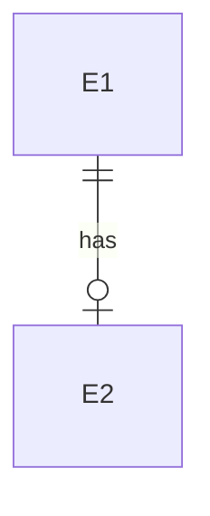

# Sensor data

> **Counts:** 2 E · 1 M
> **Based on:** requirements.md (2026-11-20), resource-math.md (2026-11-20), contracts.md (2026-11-20).

## Entity catalog

| ID | Entity | Meaning | Writers (actors) | Volume | Growth | Retention | Storage class | Sensitivity | Needs | Serves |
|---|---|---|---|---|---|---|---|---|---|---|
| E-1 | Sensor registration | One activation of a physical sensor | Operator | DC-1 slots × 16 B | 16 B per registration up to the limit | Until removal or shutdown | memory | internal | One active registration per physical sensor | FR-1 |
| E-2 | Current reading | Most recent accepted temperature for one active sensor | Controller on receipt of a sensor sample | Up to DC-1 slots × 24 B | 24 B on first reading, then zero net growth per update | Until registration removal or shutdown | memory | internal | Accept only a newer sequence number for the same registration | FR-1 |

## Logical fields

Include fields where identity, units, constraints, or interpretation affect a requirement. For this example, the sampler learns its registration ID during registration.

| Entity | Field | Meaning and constraint |
|---|---|---|
| E-1 | sensor ID | Identifies the physical sensor across registrations. |
| E-1 | registration ID | Fresh for each registration, including after restart. A retired ID cannot be reused while its frames could still arrive. |
| E-2 | registration ID | Identifies the reading and its owning registration. At most one current reading exists per registration. |
| E-2 | sequence | Nonnegative sample number, strictly increasing at the sampler within a registration. Reset or rollover requires a fresh registration. Gaps are allowed. |
| E-2 | temperature | Measured temperature in degrees Celsius. The frame contract defines its encoding. |

## Relations

Each reading belongs to exactly one active sensor. A newly registered sensor can have zero readings. After its first accepted sample it has one. The sequence number determines which update wins, a rule the cardinality alone cannot express.

## Lifecycle and copies

| ID | Created by | Changed by | Deleted by / when | Copies | Copy lifetime |
|---|---|---|---|---|---|
| E-1 | Operator registers a sensor | Identity fixed for the registration | Operator removes sensor or instrument shuts down | Registration ID held by sampler and carried in sample frames | Sampler retains the ID until deregistration or shutdown. In-flight frames can outlive registration. |
| E-2 | Controller accepts first sample | Controller accepts a newer sample | Controller deletes the reading on registration removal or shutdown | Display buffer | Cleared on refresh within 1 s, or at shutdown |

## Entity states

**Entity:** E-1 · **Aspect:** reading availability · **Representation:** derived from the E-2 relation

| Value | Condition |
|---|---|
| awaiting_sample | The active registration has zero current readings. |
| has_reading | The active registration has one current reading. |

Governing mechanism: [MC-1 sample acceptance](mechanics.md#MC-1).

## Memory strategy

| ID | Region | Contents | Lifetime | Size | Allocation | On exhaustion | Serves / limit |
|---|---|---|---|---|---|---|---|
| M-1 | Receive ring | Incoming sample frames | Controller runtime | 200 frames × 24 B | Static | Count and drop incoming frame | FR-1 |
